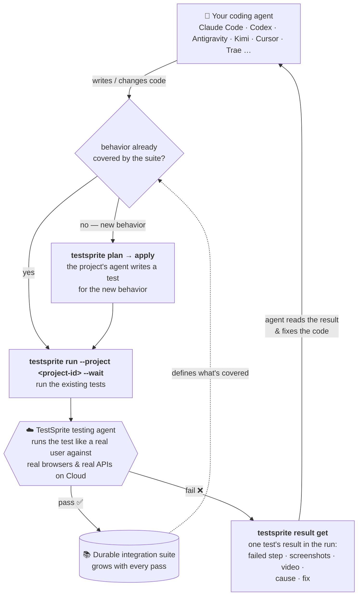

<div align="center">

<a href="https://www.testsprite.com">
  <picture>
    <source media="(prefers-color-scheme: dark)" srcset="assets/testsprite-logo-dark.png">
    <source media="(prefers-color-scheme: light)" srcset="assets/testsprite-logo-light.png">
    
  </picture>
</a>

### The verification layer for the agentic coding era.

AI ships code in minutes — verifying it hasn't. `testsprite` opens your live app, uses it like a real user, and shows your coding agent exactly what broke — so it fixes its own work before a bug ever reaches you.

<sub><b>Proof, in public: verification beats model size.</b> With this CLI in the loop, the cheapest model in the field shipped the most correct app on an open leaderboard — <b>89%</b>, at half the cost of the priciest one. <a href="https://codercup.ai">See the leaderboard →</a></sub>

<p>
  <a href="https://www.npmjs.com/package/@testsprite/testsprite-cli"></a>
  <a href="https://www.npmjs.com/package/@testsprite/testsprite-cli"></a>
  <a href="#quickstart"></a>
  <a href="./LICENSE"></a>
  <a href="https://github.com/TestSprite/testsprite-cli/actions/workflows/ci.yml"></a>
</p>

<p>
  <a href="https://www.testsprite.com"></a>
  <a href="https://docs.testsprite.com/cli/getting-started/overview"></a>
  <a href="https://x.com/Test_Sprite"></a>
  <a href="https://www.linkedin.com/company/testsprite"></a>
  <a href="https://discord.gg/GXWFjCe4an"></a>
</p>

⭐ _Help us reach more developers and grow the TestSprite community. Star this repo!_

</div>

<video src="https://github.com/user-attachments/assets/eca90a91-93ef-49f6-8d13-86b4eb25f4cf" controls muted></video>

<p align="center"><sub><b><a href="https://github.com/user-attachments/assets/eca90a91-93ef-49f6-8d13-86b4eb25f4cf">▶ Watch the launch video</a></b> — the three hard limits every coding agent hits, and the loop that breaks them (4 min).</sub></p>

---

## What is it?

[TestSprite](https://www.testsprite.com) is the AI testing platform 100,000+ teams use to test their software, frontend and backend — in the cloud, against the live product, not mocks. This repo is its official CLI.

It puts that platform in your coding agent's hands: the agent verifies every behavior it ships, and what broke comes back as **one result** — the failed step, its cause and a fix — it can act on, with no dashboard scraping. Humans drive the same surface from a terminal or CI.

## ⭐️ Star the Repository


If you find `testsprite` useful, a GitHub Star ⭐️ would be greatly appreciated — it helps other builders (and their agents) find the project, and stars notify you about new releases.

## Quickstart

You need Node.js 20.19+ on the 20.x line, 22.13+ on 22.x, or 24 or later. [Using 0.16? Read its command reference.](https://github.com/TestSprite/testsprite-cli/blob/v0.16.0/DOCUMENTATION.md)

From your app's repository, install the CLI and run setup. It prompts for your [workspace API key](https://www.testsprite.com/dashboard-v3/settings/apikey) and installs the skills for the coding agents it detects.

```bash
npm install -g @testsprite/testsprite-cli
testsprite --version
testsprite setup
testsprite auth status
```

**Choose your project and target.** Run `testsprite project list` to find an existing project. For a new frontend project, create it and add the URL where your app is running. Replace the URL below with yours and set `PROJECT_ID` to the ID printed by `project create`.

```bash
testsprite project create --type frontend --name "Checkout"
PROJECT_ID=your-project-id
testsprite project env create "$PROJECT_ID" --name staging --url https://staging.example.com
```

**Get your first test.** Ask the project's agent to propose coverage. If it asks a question in a text message, answer with `testsprite reply "your answer"`. For a question card, submit all the numbered answers together with `testsprite apply --answer 1=b --answer 2=a,c`. Review the proposed steps in the terminal and apply the plan when they match what you want to verify. For a backend project, attach the API specification with `--file ./openapi.yaml`.

```bash
testsprite plan "Verify that a guest can place an order with a test card" --project "$PROJECT_ID" --steps
```

```bash
testsprite apply
testsprite test list --project "$PROJECT_ID"
```

**Run and inspect.** A project run waits for the suite when you pass `--wait`. Exit 0 means it passed. On exit 1, look for a failed or blocked row in `results[]` and copy its `resultId` to inspect the error and available evidence. If no row failed, check `runFailures` for an execution-level error such as cancellation. Without `--output json`, each run also prints a `Dashboard:` link that opens it in the Portal.

```bash
testsprite run --project "$PROJECT_ID" --wait --output json
```

```bash
RESULT_ID=your-result-id
testsprite result get "$RESULT_ID" --out ".testsprite/results/$RESULT_ID"
```

After deploying a fix, run the affected test again with `testsprite run "$TEST_ID" --wait`, using its ID from `test list`. To resume waiting for a run you already started, use its **run ID** with `testsprite run wait "$RUN_ID"`. The [scripting example](./DOCUMENTATION.md#output--scripting) shows how to extract both IDs and preserve the verdict in CI.

## Testing an environment on your machine

Start your frontend app on port 3000. To run the project's saved tests against the app on this machine, supply the port. The CLI opens a tunnel and waits for the cloud runner.

```bash
testsprite run --project "$PROJECT_ID" --local 3000
```

For a local-only project, you can save the port as its first environment with `testsprite project env create "$PROJECT_ID" --name local --local 3000`. Give the project's agent a Git diff or a spec so it can propose tests without browsing localhost. Review and apply the test plan, then run with `--env local`. An ordinary Ctrl-C detaches a public run. With a tunnel this command opened, Ctrl-C cancels unfinished work by default and closes the tunnel. [Local frontend testing and tunnels](./DOCUMENTATION.md#local-frontend-testing-and-tunnels)

## Commands

| Task                                             | Command                                                                                |
| ------------------------------------------------ | -------------------------------------------------------------------------------------- |
| Check credentials or install coding-agent skills | `auth status`, `setup`, `agent status`                                                 |
| Manage a project and its targets                 | `project list`, `project create`, `project env`                                        |
| Propose tests, review them and save them         | `plan`, `status`, `reply`, `reject`, `apply`                                           |
| Find the ID or steps of a saved test             | `test list --project <id>`, `test get <test-id>`                                       |
| Launch a project, named tests or a saved list    | `run --project <id>`, `run <test-id...>`, `run --testlist <list-id>`                   |
| Follow or cancel an execution                    | `run wait <run-id...>`, `run cancel <run-id...>`                                       |
| Read results and download evidence               | `result list --run <run-id>`, `result list --test <test-id>`, `result get <result-id>` |
| Automate scheduled tests or a pull-request gate  | `schedule`, `ci init github`, `ci run`                                                 |

For test lists, tunnel management, usage, diagnostics, profiles and exit codes, see the [command reference](./DOCUMENTATION.md#command-reference). To migrate shell scripts or previously installed agent skills from 0.16, see [Upgrading from 0.16](./DOCUMENTATION.md#upgrading-from-016).

## Why a CLI for coding agents?

- 🧪 **Tests like a real user.** Runs against a live browser or API in the cloud — real clicks, real navigation, real assertions. Not a mock.
- 🤖 **Agent-shaped output.** `run` names the run (`runId`) and each test's result in it (`resultId`). `result get <result-id>` returns that one result — the verdict, the error, its cause and fix, the failed step with its screenshot, a backend test's traceback and output, and every step — and `--out <dir>` downloads its video and each step's screenshot and page. The agent reads the run it just started, never an older one.
- **Whole-run results.** Every selector and `run wait` use the same JSON: `runs[]` describes executions, `results[]` lists individual results, and `summary` counts outcomes when waiting. A complete run can fail. Only a timeout or interruption that leaves work unfinished adds `partial: true`. A cancelled execution fails even if its existing results passed. Read detailed evidence with `result get <result-id>`.
- ♻️ **A loop, not a one-shot.** `plan → apply → run → result get → fix → run` — every pass is banked, not thrown away.
- 📐 **Scriptable & deterministic.** Stable `--output json` contract, predictable [exit codes](./DOCUMENTATION.md#exit-codes), and a `--dry-run` for previewing commands. A credentialed run preview can read environment metadata to determine whether it would open a tunnel.
- 🚦 **CI-native.** `testsprite ci init github` writes a PR gate; `testsprite ci run --project "$PROJECT_ID" --env <name> --target-url "$PREVIEW_URL"` tests each pull request's preview deployment as one run and exits with the verdict. The job summary is the execution report — the same content as the GitHub App's PR comment — plus `::error::` annotations on the checks tab, step outputs, `--summary-file` for a machine summary and `--report junit` for a JUnit sidecar. In any other CI, `testsprite ci run --project <id> --env <name> --target-url <url>` still runs the suite as one run and makes the exit code the verdict — the pull-request context, draft skip and job summary are GitHub Actions only. [Details →](./DOCUMENTATION.md#continuous-integration)
- 🔌 **One command to onboard your agent.** `testsprite setup` drops ready-made skill files into your repo — for the agents it detects you using — so your coding agent knows how to drive the loop on its own.

## How it works

Every time your agent changes code, it asks one question: **is this behavior already covered by the suite?**

- **Not yet covered** → `testsprite plan` — the project's agent writes a test for the new behavior; `testsprite apply` saves it, then run it.
- **Already covered** → `testsprite run --project <project-id> --wait` — run the existing tests, so nothing that used to work breaks silently.
- **Something fails** → `testsprite result get <result-id>` — the failed step, its cause and a fix; the agent fixes the code and runs again.

Every pass is banked into a durable suite, so coverage compounds as the project grows — a lasting record of every requirement it has ever gotten right, far bigger than any context window.



The cloud is a black box on purpose: your agent describes intent and reads results. It never has to know _how_ the test was driven — only _what_ a real user experienced.

## Proved in public

On [**CoderCup**](https://codercup.ai) — an open leaderboard where frontier coding agents build the _same_ app under the _same_ rules, with TestSprite as the referee — the **cheapest** model in the field shipped the **most correct** app on the board: **89%**, at half the cost of the priciest one.

That's the point of all of this: you no longer need the biggest, most expensive model to ship software you can trust — top-tier quality, without paying top-tier prices, within reach of every team.

## Getting help

- 📚 **CLI reference** — [DOCUMENTATION.md](./DOCUMENTATION.md)
- 🌐 **Platform docs** — [docs.testsprite.com](https://docs.testsprite.com)
- 🐛 **Issues & feature requests** — [GitHub issues](https://github.com/TestSprite/testsprite-cli/issues)
- 💬 **Quick questions** — [Discord](https://discord.gg/GXWFjCe4an), or `testsprite --help` / `testsprite run --help` right in your terminal
- 📝 **Changelog** — [CHANGELOG.md](./CHANGELOG.md)

## Contributing

Contributions are welcome — the CLI is plain TypeScript/Node (20.19+, 22.13+, or 24+), tested with Vitest, built with `tsc`. Getting a dev loop running takes a minute:

```bash
git clone https://github.com/TestSprite/testsprite-cli.git
cd testsprite-cli && npm install
npm run build       # tsc → dist/ ; try it: node dist/index.js --help
npm test            # unit suite — no network or credentials needed
npm run lint:fix    # ESLint
npm run typecheck   # tsc --noEmit
```

Pull requests target the `main` branch. The full guide — build from source, test tiers, CI checks, branches, project layout — is in [CONTRIBUTING.md](./CONTRIBUTING.md).

**Support** — if you need any help, we're responsive on [Discord](https://discord.gg/GXWFjCe4an), and feel free to email us at [contact@testsprite.com](mailto:contact@testsprite.com) too.

## License

[Apache-2.0](./LICENSE) © TestSprite
